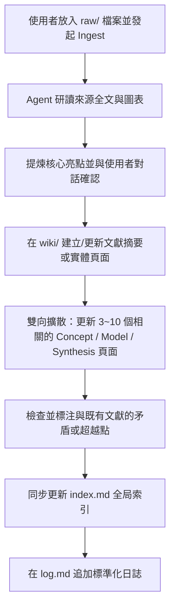

# AGENTS.md — LLM Wiki 維護手冊與系統規範

> 本檔案為 LLM Agent（如 Antigravity, Claude Code, OpenAI Codex, OpenCode 等）在維護本知識庫時遵循的最高行動規範。
> 本知識庫遵循 **Andrej Karpathy 提出的 LLM Wiki 範式**：將 Wiki 視為隨時間演化、具複利效應（Compounding）的長效知識架構，而非僅作單次無狀態的 RAG 檢索。

---

## 1. 核心哲學 (Core Philosophy)

1. **持久複利架構（Persistent, Compounding Artifact）**：
   - 傳統 RAG 是每次提問時重新檢索片段並從頭推理；本 Wiki 則是每一次攝入新文獻或完成深思後，將精華與洞見編譯成結構化的 Markdown 頁面並長久保存。
   - 知識庫越讀越厚、跨文件連結越結越密、觀點衝突被即時標記、全局綜合視角持續迭代。
2. **人機分工定義（Division of Labor）**：
   - **人類研究員（User）**：掌控資訊輸入來源（Sourcing）、探索方向、提出高價值研究假說與關鍵問題。
   - **Agent（LLM）**：負責全部繁重瑣碎的維護工作（Summarizing、Cross-referencing、Filing、Bookkeeping、Contradiction checking、Linting）。
3. **工作介面隱喻**：
   - **Obsidian 是 IDE**（人類可視化閱讀、瀏覽關聯圖譜 Graph View、點擊跳轉）。
   - **LLM Agent 是工程師**（編寫、重構、索引、除錯與維護 Wiki）。
   - **Wiki 是 Codebase**（結構分明、強型別/標準 Frontmatter、高內聚低耦合的知識程式庫）。
   - **Raw Sources 是唯讀資料庫**（不可篡改的事實來源）。

---

## 2. 三層架構 (Three-Layer Architecture)

```
LLM Wiki 工作目錄
├── raw/                 # 【第一層：原始資料層】唯讀、客觀事實依歸（Immutable Source of Truth）
├── wiki/                # 【第二層：知識資產層】LLM 完全擁有並持續重構的 Markdown 知識庫
├── AGENTS.md            # 【第三層：規格合約層】定義維護規範與工作流的 Schema（即本檔案）
├── index.md             # 全局內容分類索引（快速檢索錨點）
└── log.md               # 追溯演化歷史的時間日誌（Append-only Event Log）
```

### 職責劃分
- **`raw/`（原始輸入）**：
  - 放置原始論文、技術部落格、會議演講稿、速記筆記、截圖或圖表。
  - **原則：Agent 只能讀取，嚴禁修改或刪除 `raw/` 內的任何原始檔案。**
- **`wiki/`（知識精煉）**：
  - 由 Agent 全權撰寫、更新、交叉連結的 Markdown 文件。
  - 包含核心概念、模型檔案、架構剖析、訓練技術、評測基準、橫向對比與綜合觀點。
- **`index.md`（內容索引）**：
  - 依領域分類的全局目錄，每頁提供連結與一句話核心結論（One-line summary）。
- **`log.md`（操作日誌）**：
  - 記錄每次 Ingest、Query 沉澱、Lint 巡檢的歷史，支援 Unix 工具分析。

---

## 3. 資料夾體系與分類標準 (LLM Research Taxonomy)

專為**大語言模型（LLM）相關研究**設計的分類路徑如下：

| 資料夾路徑 | 涵蓋範疇 | 範例頁面 |
| :--- | :--- | :--- |
| `wiki/concepts/` | 基礎與進階技術概念、數學原理、理論機制 | `attention-mechanism.md`, `test-time-compute.md`, `kv-cache.md` |
| `wiki/models/` | 具體模型家族、開源/閉源模型技術剖析 | `deepseek-r1.md`, `llama-3.md`, `claude-3-5-sonnet.md` |
| `wiki/architectures/` | 模型架構變革、主幹網路設計、注意力變體 | `transformer.md`, `mixture-of-experts.md`, `mamba-ssm.md` |
| `wiki/methods/` | 訓練演算法、優化技巧、微調與後訓練方法 | `dpo.md`, `grpo.md`, `speculative-decoding.md`, `fp8-quantization.md` |
| `wiki/agents/` | Agent 體系架構、工具使用、自主工作流、協議 | `mcp-protocol.md`, `react-pattern.md`, `code-interpreter.md` |
| `wiki/evaluations/` | 基準評測集、評估標準、排行榜與基準指標 | `swe-bench.md`, `gpqa.md`, `lmsys-arena.md` |
| `wiki/organizations/` | 關鍵實驗室、機構、開源社群動向與技術風格 | `openai.md`, `deepseek-ai.md`, `anthropic.md` |
| `wiki/comparisons/` | 橫向評比、架構差異對照、演算法優劣分析 | `reasoning-models-comparison.md`, `alignment-methods-dpo-vs-ppo.md` |
| `wiki/syntheses/` | 演化中的研究綜合論述、技術趨勢前瞻、全景圖 | `llm-reasoning-frontier.md`, `open-source-vs-closed-source-gap.md` |

---

## 4. 三大核心操作流程 (Workflows)

### 流程一：文獻攝入（Ingest Workflow）
當使用者將新資料（PDF、Markdown 文章、筆記等）放入 `raw/` 並發出處理指令時執行：



#### Ingest 執行細則：
1. **深度研讀**：徹底解析原始文獻的動機、核心貢獻、實驗基準、局限性。
2. **提取實體與概念**：識別出涉及的模型、架構、演算法，若既有 Wiki 已有對應頁面，則準備更新；若無，則評估是否新建頁面。
3. **連鎖更新（Ripple Update）**：
   - 一篇高質量的論文攝入，往往應觸動 **3 到 10 個相關頁面**的更新！
   - 例如攝入《DeepSeek-R1》論文：
     - 新建 `wiki/models/deepseek-r1.md`
     - 更新 `wiki/methods/grpo.md`（補充其純強化學習訓練細節）
     - 更新 `wiki/concepts/test-time-compute.md`（補充自我反思與長思維鏈發現）
     - 更新 `wiki/comparisons/reasoning-models-comparison.md`（加入與 OpenAI o1 的對照）
     - 更新 `wiki/organizations/deepseek-ai.md`
4. **矛盾標註（Contradiction Flagging）**：
   - 若新文獻推翻了早期論點（如「純 RL 不需冷啟動資料亦能湧現推理能力」對比早期的「需要大量優質 SFT 引導」），必須在相關頁面明確標註：
     > ⚠️ **觀點演進與分歧**：[來源 A] 認為 ...；然而 [來源 B] 實驗證明 ...
5. **更新索引與日誌**：依規範同步 `index.md` 與 `log.md`。

---

### 流程二：深度查詢與成果回流（Query & Compound Workflow）
當使用者提出複雜研究問題（如「當前開源模型後訓練對齊技術的主要流派與優缺點為何？」）時執行：

1. **查閱索引（Index Lookup）**：
   - 優先調閱 `index.md` 與相關子領域頁面，鎖定最相關的 3~5 篇 Wiki 文件。
2. **多文檔綜合推理（Synthesizing）**：
   - 彙整各頁面的事實、實驗數據、局限性，產出結構化、具洞見的回答，並附帶 Wiki 內部連結與來源出處引用。
3. **成果回流（Filing Back）**：
   - **這是 Karpathy LLM Wiki 最關鍵的精神**：精華的回答絕不隨聊天歷史湮滅！
   - 凡是具備深度分析、橫向比較或前瞻綜述價值的回答，Agent 主動提議或直接將其沉澱為：
     - `wiki/comparisons/<topic-comparison>.md` 或
     - `wiki/syntheses/<evolving-synthesis>.md`
   - 將新頁面登錄至 `index.md`，並在 `log.md` 記上一筆 `query | ...`。

---

### 流程三：健康巡檢（Lint Workflow）
當使用者要求對知識庫進行健康體檢，或定期自主維護時執行：

1. **孤島檢測（Orphan Pages）**：找出沒有任何內部頁面連結指向它的邊緣頁面，為其在合適的 Concept 或 Synthesis 頁面中補上連結。
2. **矛盾與陳舊主張（Contradictions & Stale Claims）**：識別早期假設是否已被後續的新文獻超越或否定。
3. **斷鏈檢測（Broken Links）**：檢查所有 `[[Page]]` 或 Markdown 連結是否指向不存在的檔案。
4. **缺失實體（Missing Entities）**：掃描各頁面中反覆被提及 3 次以上但尚未建立專門頁面的核心關鍵字（如特定的注意力變體、新基準集），提議新建頁面。
5. **研究缺口建議（Research Gaps & Web Search Suggestions）**：指出知識庫中薄弱的技術環節，主動建議人類研究員可補充哪些方向的論文或技術報告。

---

## 5. 檔案格式與書寫規範 (Style & Metadata Standards)

### 5.1 YAML Frontmatter 規範
所有 `wiki/` 下的頁面均須包含標準 Frontmatter，以利 Obsidian Dataview 插件檢索與管理：

```markdown
---
title: "頁面繁體中文標題 (English Title)"
aliases: ["別名1", "英文縮寫"]
type: concept | model | architecture | method | agent | evaluation | organization | comparison | synthesis
tags:
  - llm/post-training
  - research/alignment
created: 2026-11-06
updated: 2026-11-06
status: seed | evolving | mature
sources:
  - "[[raw/papers/example-paper.pdf]]"
---
```

### 5.2 雙向連結語法（Wikilinks）
- 頁面之間的內部引用優先使用 Obsidian 風格的 Wikilinks：`[[檔案名或路徑|顯示文字]]` 或標準 Markdown 連結 `[顯示文字](路徑)`。
- 連結必須精確指向具體頁面，增強 Obsidian Graph View 的星系網絡連結度。
- 若提及具體技術概念，主動包裹連結，例如：「該模型採用了 [[kv-cache|KV 快取優化]] 與 [[grpo|群組相對策略優化]]」。

### 5.3 術語中英文對照規範 (Terminology Guide)
為保持研究專業性，遵循繁體中文學術界與產業通用習慣，**保留核心英文名詞或中英雙標**：

| 英文術語 | 建議中文規範 | 備註 |
| :--- | :--- | :--- |
| Pre-training | 預訓練 | 常見通用名詞 |
| Post-training | 後訓練 | 包含 SFT、RLHF、DPO 等階段 |
| Fine-tuning (SFT) | 微調（監督式微調） | 縮寫為 SFT |
| Alignment | 對齊 | 如價值對齊、指令對齊 |
| Inference / Serving | 推理 / 部署推論服務 | 台灣與國際中文社群常稱推論/推理 |
| Test-time Compute | 測試時計算 / 思考計算量 | o1/R1 類別之推理鏈擴展 |
| Context Window | 上下文窗口 / 語境長度 | |
| Mixture of Experts (MoE) | 混合專家架構 (MoE) | 保留 MoE 簡寫 |
| Speculative Decoding | 推測解碼 / 投機解碼 | 推理加速技術 |
| Reinforcement Learning | 強化學習 (RL) | |
| Grounding / Hallucination | 依據錨定 / 模型幻覺 | |

---

## 6. 核心維護合約：`index.md` 與 `log.md`

### 6.1 `index.md` 規範
- 位於根目錄，是全局導航的中樞。
- 分門別類列出所有 Wiki 頁面，**每一條目必須附帶一句精闢的一句話摘要（One-line summary）**。
- 當新增或大幅修改頁面時，Agent 必須同步更新 `index.md`。

### 6.2 `log.md` 規範
- 位於根目錄，採只追加（Append-only）原則。
- 每個日誌條目必須以統一前綴開頭，確保可以使用標準 Shell 指令檢索（例如 `grep "^## \[" log.md | tail -5`）：
  - `## [YYYY-MM-DD] ingest | <來源標題>`
  - `## [YYYY-MM-DD] query | <查詢主題或沉澱頁面>`
  - `## [YYYY-MM-DD] lint | <健康巡檢結果摘要>`
- 條目內容應條列出：涉及修改/新建的 Wiki 頁面、核心發現或處理事項。

---

## 7. Agent 自律守則 (Ground Rules)

1. **嚴禁破壞原始文獻**：絕對不改動 `raw/` 內的任何原始檔案。
2. **拒絕空洞敷衍**：寫入 Wiki 的內容必須有實質技術深度（包含公式動機、核心架構圖解、關鍵超參數、實驗量化結論）。
3. **動態編織網絡**：新建頁面時，至少主動連結到 2 個既有頁面，並在既有頁面建立反向連結，嚴防孤島頁面。
4. **與使用者緊密合作**：在文獻攝入或大幅重構前，可簡述預計更新的頁面清單，尊重使用者的研究重心引導。
