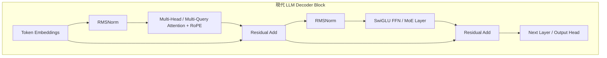

# Transformer 架構基礎與演進 (Transformer Architecture)

## 1. 核心機制：自注意力 (Scaled Dot-Product Attention)

Transformer 最具開創性的設計在於摒棄了循環神經網絡（RNN）的遞歸依賴，改以全局平行化的注意力機制捕捉序列依賴性：

$$\text{Attention}(Q, K, V) = \text{softmax}\left(\frac{QK^T}{\sqrt{d_k}}\right)V$$

其中：
- $Q$ (Query), $K$ (Key), $V$ (Value) 均由輸入向量經線性變換投影而得。
- 縮放因子 $\sqrt{d_k}$ 避免點積值過大導致 Softmax 梯度進入飽和飽和區。

---

## 2. 現代大語言模型之主流演進

原始 Transformer 為包含 Encoder 與 Decoder 的序列到序列（Seq2Seq）架構，而現代生成式 LLM（如 GPT 系列、Llama 系列、DeepSeek 系列）多數收斂至 **Decoder-only** 架構。

### 關鍵現代化改進 (Modern Variants)
1. **正規化 (Normalization)**：
   - 捨棄 Post-LN，改採 **Pre-LN** 或更輕量的 **RMSNorm**，顯著提高深層網路訓練穩定性。
2. **位置編碼 (Positional Embedding)**：
   - 從絕對正弦位置編碼演進為 **旋轉位置編碼 (Rotary Position Embedding, RoPE)**，具備優秀的相對距離衰減特性與長度外推能力。
3. **注意力與快取優化 (Attention & KV Cache)**：
   - 傳統 Multi-Head Attention (MHA) 在長序列推論時產生龐大的 [[wiki/concepts/kv-cache|KV 快取]] 顯存佔用。
   - 現代架構廣泛轉向 **MQA (Multi-Query Attention)**、**GQA (Grouped-Query Attention)** 或 **MLA (Multi-head Latent Attention)**。
4. **前饋神經網路 (FFN)**：
   - 使用包含門控機制的 **SwiGLU** 激活函數取代傳統 ReLU / GELU，或進一步升級為稀疏的混合專家架構（MoE）。

---

## 3. 關聯維基頁面導航
- **概念延伸**：[[wiki/concepts/kv-cache|KV 快取優化機制]]
- **推論演算法**：[[wiki/concepts/test-time-compute|測試時計算與推理擴展]]
- **實體模型應用**：[[wiki/models/deepseek-r1|DeepSeek-R1 (MLA + MoE)]]
- **全景圖**：[[wiki/syntheses/llm-research-landscape|LLM 研究技術全景圖]]
