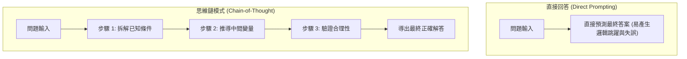

# 思維鏈技術 (Chain-of-Thought, CoT)

## 1. 概念定義與基本機制

**思維鏈（Chain-of-Thought, CoT）** 是促使大語言模型在輸出最終答案之前，生成一系列中間推理步驟（Intermediate Reasoning Steps）的技術。

在傳統的直接回答（Direct Answer）模式下，自迴歸模型必須在一個或數個 Token 內直接預測出最終答案（例如多位數運算或複雜邏輯問題的結論），計算容量受限於固定層數前向傳遞；而思維鏈透過在上下文中寫出中間步驟，使後續 Token 能夠以先前生成的推理步驟作為條件依賴，將複雜推理負擔攤提至整個序列維度。

---

## 2. 兩種主流實踐方式

### 2.1 零樣本思維鏈 (Zero-Shot CoT)
- **觸發方式**：在提示詞結尾加入「讓我們一步步思考（Let's think step by step）」或「請詳細分析推理過程」。
- **特點**：無需額外範例，通用性強，可立即可靠地降低多步驟運算中的粗心失誤。

### 2.2 少樣本思維鏈 (Few-Shot CoT)
- **觸發方式**：在 Prompt 中提供包含「問題 $\rightarrow$ 完整思維鏈步驟 $\rightarrow$ 答案」的少樣本（Few-shot）示範。
- **特點**：能精準引導模型遵循特定領域的推理邏輯或推導格式（如特定符號證明、代碼演算流程）。

---

## 3. ⚠️ 典範演進與深度分歧：Prompt 引導 vs. RL 自主湧現

思維鏈的研究在 LLM 發展史中經歷了重大質變，在此特別標注技術演化脈絡：

> ⚠️ **技術範式演進**：
> - **早期範式（Prompt-Driven CoT）**：將 CoT 視為提示詞工程（Prompt Engineering）技巧。模型僅在收到人類明確的「一步步思考」指令或範例引導時，模仿人類的思考格式進行推導。
> - **現代範式（Emergent Long CoT via RL）**：在 [[wiki/concepts/test-time-compute|測試時計算]] 與 [[wiki/models/deepseek-r1|DeepSeek-R1]] 中，思維鏈不再依賴外部 Prompt 刻意誘發，而是模型在純強化學習（如 [[wiki/methods/grpo|GRPO]]）與正確性獎勵的驅動下，**自主湧現**的探索、試錯、回溯與自檢行為。

---

## 4. 關聯維基頁面導航
- **提示架構依託**：[[wiki/methods/crct-framework|CRCT 結構化 Prompt 模型]]
- **提示工程全貌**：[[wiki/concepts/prompt-engineering|提示詞工程 (Prompt Engineering)]]
- **演算法前沿**：[[wiki/concepts/test-time-compute|測試時計算與推理擴展]]、[[wiki/methods/grpo|GRPO 演算法]]
- **模型實踐**：[[wiki/models/deepseek-r1|DeepSeek-R1]]
- **全景導航**：[[wiki/syntheses/llm-research-landscape|LLM 研究技術全景圖]]
