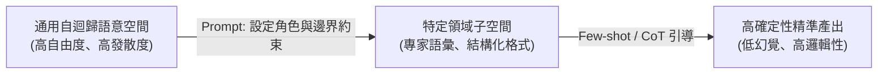

# 提示詞工程 (Prompt Engineering & Context Conditioning)

## 1. 概念定義與理論本質

在自迴歸大語言模型（如 GPT-4o、Claude 3.5 Sonnet、Gemini 1.5 Pro）中，模型的本質是根據前文條件機率預測下一個 Token：

$$P(w_t \mid w_1, w_2, \dots, w_{t-1})$$

**提示詞工程（Prompt Engineering）** 並非僅僅是文字修辭技巧，其理論本質是 **上下文條件化（Context Conditioning）**：
- 使用者輸入的提示詞構成先驗機率分佈的條件約束。
- 高質量的提示詞能夠引導模型在數百億至數千億參數的龐大語意空間中，迅速收斂至對應專業領域的子分佈，抑制與任務無關的發散機率，從而大幅降低模型幻覺（Hallucination）。

---

## 2. 現代提示詞核心範式：Prompt as Code

隨著系統化開發的需求，提示詞逐漸由模糊的自然語言演變為具有嚴格架構的「程式碼化設計」（Prompt as Code）：

1. **結構化四元組模型**：
   - 採用 [[wiki/methods/crct-framework|CRCT 架構]]：Role（角色）、Context（情境）、Targets（目標）、Rules（約束），將語意任務模組化分解。
2. **語意標籤邊界隔離（XML Tag Isolation）**：
   - 利用 XML/HTML 標籤（如 `<role>`, `<context>`, `<instructions>`, `<constraints>`）將不同功能的指示清楚隔離。
   - 避免長提示詞中「背景說明」與「執行任務」互相混淆，大幅增強現代長上下文模型對邊界條件的捕捉能力。
3. **少樣本示範 (Few-Shot Demonstration)**：
   - 在輸入中提供 1~3 個具體的 input-output 對偶範例，利用模型原生的上下文學習（In-Context Learning）能力對齊輸出格式。
4. **推理引導 (Reasoning Guidance)**：
   - 結合 [[wiki/concepts/chain-of-thought|思維鏈 (Chain-of-Thought, CoT)]]，透過「一步步思考」等觸發詞將複合難題拆解為鏈狀子任務。

---

## 3. 與後訓練對齊及測試時計算的關係

- **Prompting vs. Fine-Tuning**：微調改變模型權重參數，而 Prompt Engineering 在權重凍結的前提下動態激活特定知識路徑，具備極高的迭代速度與低成本優勢。
- **演進關聯**：早期的 CoT 是純粹透過 Prompt 觸發的啟發式方法；而在現代推理模型中，此思維模式已進一步演進為由純強化學習驅動的自主反思機制（參見 [[wiki/concepts/test-time-compute|測試時計算]] 與 [[wiki/models/deepseek-r1|DeepSeek-R1]]）。

---

## 4. 關聯維基頁面導航
- **核心架構方法**：[[wiki/methods/crct-framework|CRCT 結構化 Prompt 架構]]
- **推論引導**：[[wiki/concepts/chain-of-thought|思維鏈 (Chain-of-Thought, CoT)]]
- **推論擴展演進**：[[wiki/concepts/test-time-compute|測試時計算與推理擴展]]
- **全局技術地圖**：[[wiki/syntheses/llm-research-landscape|LLM 研究技術全景圖]]
