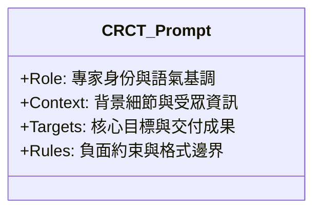

# CRCT 結構化 Prompt 設計模型 (CRCT Framework)

## 1. 框架提出動機與核心概述

未經結構化組織的 Prompt 容易因語意模糊、指示衝突或缺乏邊界限制，導致 LLM 出現隨機發散或幻覺。**CRCT 架構** 將一個標準 Prompt 抽象拆解為四個高內聚、低耦合的核心模組：

```
CRCT = Role (角色) + Context (情境) + Targets (目標) + Rules (約束)
```



---

## 2. 四大模組深入拆解

### 2.1 Role (角色設定)
- **職責**：賦予 AI 具體的專家角色、背景經驗與對話語氣。
- **底層效應**：透過設定「擁有 10 年經驗的高級架構師」或「資深 SEO 專家」，直接收斂模型解碼時的詞彙分佈（Vocabulary distribution），優先調取專業術語體系。

### 2.2 Context (情境脈絡)
- **職責**：提供當前任務的背景、業務情境、目標受眾（Target Audience）及現有資料。
- **底層效應**：將通用的生成任務錨定（Grounding）在真實需求場景中，防止產出空泛不切實際的內容。

### 2.3 Targets (目標與核心任務)
- **職責**：清晰列出期望產出的核心 Deliverables，通常採用條列式清單指定。
- **底層效應**：讓自迴歸模型在注意力的前序鍵值對中清楚鎖定任務清單，逐步依序完成各子項。

### 2.4 Rules (約束與邊界條件)
- **職責**：規定輸出格式、負面限制（Negative constraints，即「不要做什麼」）以及品質邊界。
- **底層效應**：修剪潛在的不良生成路徑，例如「不要引用未經驗證的第三方庫」、「必須輸出 JSON 格式」、「語氣親切嚴謹」。

---

## 3. 模組化封裝實踐：XML 標籤模式

在工程落地時，CRCT 模型通常配合 XML 標籤進行結構化封裝，提供現代長上下文模型最清晰的語意邊界：

```xml
<role>
你是一位經驗豐富的系統架構師與開源軟體維護者。
</role>

<context>
我們正在重構一套基於 Python 的微服務系統，需優化高並發下的資料庫連接池效能。
</context>

<targets>
請提供：
1. 找出潛在的連線洩漏風險點。
2. 提供基於 async/await 的連接池重構代碼範例。
</targets>

<rules>
- 必須遵循 PEP 8 規範並包含完整 Type Hints。
- 嚴禁使用同步阻塞式 I/O 函式庫。
- 輸出以繁體中文與 Markdown 格式呈現。
</rules>
```

---

## 4. 關聯維基頁面導航
- **上層概念**：[[wiki/concepts/prompt-engineering|提示詞工程 (Prompt Engineering)]]
- **進階推論技巧**：[[wiki/concepts/chain-of-thought|思維鏈 (Chain-of-Thought, CoT)]]
- **全景梳理**：[[wiki/syntheses/llm-research-landscape|LLM 研究技術全景圖]]
