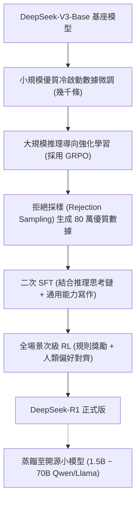

# DeepSeek-R1 推理大模型剖析 (DeepSeek-R1 Deep Dive)

## 1. 模型概覽與開創性貢獻

DeepSeek-R1 是 DeepSeek 團隊於 2025 年初發布的頂級開源推理模型，展示了開源社群比肩 OpenAI o1 正式版推理能力的重大突破。

其最關鍵的研究貢獻在於證明了：
1. **純強化學習自我湧現**：不需龐大的人類標註 SFT 冷啟動資料，僅透過純 RL 演算法即可激發強大且自主反思的 [[wiki/concepts/test-time-compute|長思維鏈推理能力]]（DeepSeek-R1-Zero）。
2. **多階段多策略訓練管線**：透過小規模高質量冷啟動 $\rightarrow$ 大規模推理強化學習 $\rightarrow$ 拒絕取樣蒸餾 $\rightarrow$ 全領域對齊，解決純 RL 帶來的語系混雜與可讀性差的問題。
3. **蒸餾（Distillation）遠勝於小模型純 RL**：將 R1 的長思維鏈推理能力直接蒸餾至 Qwen、Llama 等小尺寸模型（1.5B ~ 70B），表現遠優於小模型直接執行 RL。

---

## 2. 訓練演化管線 (Training Pipeline)

### 關鍵技術要點
- **演算法核心**：採用 Critic-free 的 [[wiki/methods/grpo|群組相對策略優化 (GRPO)]]，以極低的顯存開銷在極大規模叢集上運行長時間多步採樣。
- **獎勵機制 (Rewards)**：
  - **準確度獎勵 (Accuracy Rewards)**：基於正則匹配（數學）或代碼編譯器判定是否為確定性正解。
  - **格式獎勵 (Format Rewards)**：強制模型將思考過程置於 `<think> ... </think>` 標籤內。
  - **語言一致性獎勵**：懲罰思考過程中的隨意語系混雜現象。

---

## 3. "Aha Moment" 頓悟現象

在純 RL 訓練的 `DeepSeek-R1-Zero` 中，研究者觀察到模型在沒有任何人類引導的情況下，學會了主動檢查自己的步驟並重新計算：

> *"...Wait, wait. Wait. That's an error. Let me recalculate that..."*

這種測試時計算的自主反思標誌著模型超越了單純的模式匹配（Pattern matching），具備了啟發式搜尋的特徵。

---

## 4. 關聯維基頁面導航
- **核心架構支撐**：[[wiki/architectures/transformer|Transformer 架構]]
- **核心訓練方法**：[[wiki/methods/grpo|群組相對策略優化 (GRPO)]]
- **理論底座**：[[wiki/concepts/test-time-compute|測試時計算與推理擴展]]
- **全景梳理**：[[wiki/syntheses/llm-research-landscape|LLM 研究技術全景圖]]
