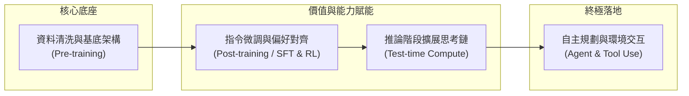

# LLM 研究技術全景圖 (LLM Research Landscape)

大語言模型（Large Language Models, LLMs）的研究範疇在過去數年間經歷了從單純「基底模型規模擴展（Pre-training Scaling）」到「後訓練對齊（Post-training Alignment）」以及當前核心前沿「測試時計算擴展（Test-time Compute Scaling）」的多維度演進。

本頁面作為本 Wiki 的宏觀導航圖景，記錄與沉澱整個技術鏈路的核心支柱。

---

## 1. 核心技術支柱

### 1.1 基底模型架構與預訓練 (Architectures & Pre-training)
- **核心主幹**：Decoder-only 結構的 [[wiki/architectures/transformer|Transformer 架構]] 為目前產業標準。近年以混合專家架構（[[wiki/architectures/mixture-of-experts|Mixture of Experts, MoE]]）實現超大參數量下的稀疏啟動，大幅降低推論成本。
- **效率機制**：注意力長序列優化（FlashAttention、RingAttention）、長度外推機制（RoPE 及其插值縮放）、[[wiki/concepts/kv-cache|KV 快取優化]]（MQA / GQA / MLA）。
- **縮放法則 (Scaling Laws)**：Chinchilla 最佳計算配比引導了預訓練階段模型參數與 Token 總量的精準配置。

### 1.2 後訓練對齊與強化學習 (Post-training & Alignment)
- **階段劃分**：
  1. **SFT (Supervised Fine-Tuning)**：建立指令遵循能力。
  2. **RLHF / Direct Preference**：從傳統 PPO 逐步演化至直接偏好優化（DPO）與無評審模型（Critic-free）的 [[wiki/methods/grpo|群組相對策略優化 (GRPO)]]。
- **範式轉移**：過去以人類偏好為核心的風格對齊，現正逐步讓位給以客觀正確性為獎勵信號的強化學習。

### 1.3 測試時計算擴展 (Test-time Compute)
- **突破性發現**：除了在預訓練（Data & Parameters）增加計算量外，推論時透過分配更多計算資源（如自主回溯、分支搜尋、驗證器 PRM 反饋），能突破預訓練知識容量的瓶頸。
- **代表進展**：[[wiki/concepts/test-time-compute|測試時計算擴展]] 是 [[wiki/models/deepseek-r1|DeepSeek-R1]] 與 OpenAI o 系列模型的關鍵核心。

### 1.4 提示詞工程與上下文條件化 (Prompt Engineering & Context Conditioning)
- **語意空間約束**：自迴歸模型的下一個 Token 生成機率高度依賴輸入的先驗條件。結構化的 [[wiki/concepts/prompt-engineering|提示詞工程]] 與 [[wiki/methods/crct-framework|CRCT 架構]] 透過角色、情境與明確規則，引導模型收斂至專業領域分佈，顯著降低幻覺率。
- **推論啟發機制**：早期的 [[wiki/concepts/chain-of-thought|思維鏈 (CoT)]] 透過提示詞中的「一步步思考」誘發多步驟解題，為後續測試時計算的自主反思奠定了理論與實務雛形。

### 1.5 自主 Agent 與工具生態 (Agents & Tool Ecosystem)
- 將 LLM 作為核心推理引擎（CPU），配合外接記憶體、工具調用（Tool-use）、模型上下文協議（MCP）與環境反饋循環（ReAct），實現高複雜度的代碼編寫與自主研究。

---

## 2. 當前研究爭鳴與前沿課題

1. **純強化學習的極限**：
   - 僅透過規則獎勵（Rule-based Rewards）是否能完全泛化至缺乏客觀答案的開放式人文與寫作領域？
2. **長上下文（Long Context）vs. RAG**：
   - 百萬 Token 窗口普及後，RAG 是否仍具價值？目前的共識偏向分層架構：RAG 負責大範圍粗篩，長窗口負責精準多跳推理。
3. **開源與閉源差距 (Open vs. Closed)**：
   - 隨著蒸餾技術、開源高品質資料集與高效 RL 演算法的普及，開放權重模型（如 DeepSeek、Llama、Qwen 系列）與閉源頂尖模型的代差顯著收窄。

---

## 3. 關聯維基頁面導航
- **概念**：[[wiki/concepts/test-time-compute|測試時計算]]、[[wiki/concepts/chain-of-thought|思維鏈]]、[[wiki/concepts/prompt-engineering|提示詞工程]]、[[wiki/concepts/kv-cache|KV 快取]]
- **架構**：[[wiki/architectures/transformer|Transformer 架構]]
- **方法**：[[wiki/methods/grpo|GRPO 強化學習演算法]]、[[wiki/methods/crct-framework|CRCT 結構化 Prompt 框架]]
- **模型**：[[wiki/models/deepseek-r1|DeepSeek-R1 推理大模型]]
